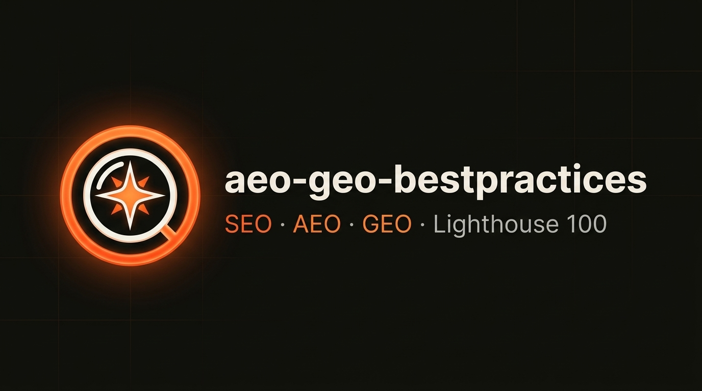

<p align="center">
  <a href="./README.md"> English</a>
  &nbsp;&middot;&nbsp;
  <a href="./README.pt-BR.md"> <b>Português</b></a>
</p>

<p align="center">
  
</p>

<p align="center">
  <a href="https://github.com/micaelgomestavares/aeo-geo-bestpractices/blob/main/LICENSE"></a>
  <a href="https://agentskills.io"></a>
  <a href="https://developer.chrome.com/docs/lighthouse"></a>
  <a href="https://github.com/micaelgomestavares/aeo-geo-bestpractices/stargazers"></a>
  <a href="https://github.com/micaelgomestavares/aeo-geo-bestpractices/issues"></a>
</p>

# aeo-geo-bestpractices

> Skill para agentes de IA que deixa qualquer landing page ou app web **encontrável por buscadores e por IAs** (SEO + AEO + GEO) e mira **98–100 em todas as categorias do Google Lighthouse 13**, inclusive a nova categoria *Agentic Browsing*.

Funciona com **Claude Code**, **Cursor**, **Google Antigravity**, **Codex**, **OpenCode** e qualquer agente compatível com o padrão aberto [Agent Skills](https://agentskills.io) (`SKILL.md`).

```bash
npx skills add micaelgomestavares/aeo-geo-bestpractices
```

---

## O que a skill faz

Quando você pede ao agente algo como *"melhora o SEO desse site"*, *"quero aparecer no ChatGPT/Perplexity"*, *"cria o llms.txt"* ou *"bate 100 no Lighthouse"*, ele segue um playbook em 5 etapas:

| Etapa | O que é aplicado |
| --- | --- |
| **1. SEO técnico** | `<title>` e `description` otimizados, `canonical` + `hreflang`, Open Graph, Twitter Cards, `robots.txt` e `sitemap.xml` com imagens e vídeo. |
| **2. AEO** (*Answer Engine Optimization*) | Um único grafo `@graph` em JSON-LD conectando `WebSite`, `Person`/`Organization`, `WebPage`, `Product`, `Course`, `VideoObject` e `FAQPage`, mais um fallback `<noscript>` semântico para crawlers que não executam JavaScript. |
| **3. GEO** (*Generative Engine Optimization*) | `/llms.txt` + `<link rel="help">`, manifesto `/.well-known/ard.json` (Agent Resource Discovery v0.91) e escolha no `robots.txt`: permitir `OAI-SearchBot` e `Claude-SearchBot` para busca, com opção de permitir ou bloquear `GPTBot` e `ClaudeBot` para possível treino dos modelos. Controles de outros provedores são separados. |
| **4. Performance e acessibilidade** | Preload do LCP com `fetchpriority="high"`, `srcSet`/`sizes` calibrados para o DPR 1.75 do Lighthouse Mobile, TBT zero (CSS na GPU + `IntersectionObserver`, `Lenis` carregado sob demanda, timers isolados) e contraste WCAG AA. |
| **5. Validação** | Script que roda o Lighthouse em **Desktop e Mobile** e lista cada auditoria que ainda não está com nota máxima. |

Antes de alterar qualquer coisa, o agente confirma o **domínio canônico** e pergunta se você quer o **FAQ visível** na página ou apenas nos dados estruturados. Ao criar ou alterar o `robots.txt`, também verifica sua preferência sobre os bots de treino da OpenAI e da Anthropic.

---

## Instalação

### Via `skills` CLI (recomendado)

Requer [Node.js](https://nodejs.org) 18+.

```bash
# No projeto atual (o CLI pergunta para quais agentes instalar)
npx skills add micaelgomestavares/aeo-geo-bestpractices

# Global, disponível em todos os seus projetos
npx skills add micaelgomestavares/aeo-geo-bestpractices -g

# Para um agente específico
npx skills add micaelgomestavares/aeo-geo-bestpractices -a claude-code
```

Também dá para usar a URL completa:

```bash
npx skills add https://github.com/micaelgomestavares/aeo-geo-bestpractices
```

### Manual

Clone o repositório e copie a pasta para o diretório de skills do seu agente:

| Agente | Projeto | Global |
| --- | --- | --- |
| Claude Code | `.claude/skills/aeo-geo-bestpractices/` | `~/.claude/skills/aeo-geo-bestpractices/` |
| Google Antigravity / genérico | `.agents/skills/aeo-geo-bestpractices/` | `~/.gemini/config/skills/aeo-geo-bestpractices/` |

Para outros agentes, prefira o `skills` CLI, que já sabe o caminho certo de cada um.

```bash
git clone https://github.com/micaelgomestavares/aeo-geo-bestpractices.git ~/.claude/skills/aeo-geo-bestpractices
```

---

## Como usar

Depois de instalada, é só pedir em linguagem natural (ou usar `/aeo-geo-bestpractices`). Aqui estão **3 prompts recomendados** para extrair o máximo da skill:

#### 1. Auditoria Rápida (Apenas inspeção)
```text
Audite esse projeto usando a skill aeo-geo-bestpractices. Liste os pontos críticos de SEO, AEO, GEO e performance antes de alterar qualquer código.
```

#### 2. Implementação Completa (Pronto para produção)
```text
Aplique o playbook completo da skill aeo-geo-bestpractices mantendo o design visual intacto. Configure o @graph JSON-LD conectado, crie o llms.txt e ard.json, e calibre o preload de LCP.
```

#### 3. Validação e Benchmark no Lighthouse
```text
Execute a validação automatizada do Lighthouse em mobile e desktop, reporte auditorias abaixo de 100 e corrija as pendências identificadas.
```

### Rodando o Lighthouse manualmente

O script de validação também pode ser usado sozinho no terminal:

```bash
# Detecta a stack, roda `npm run build` e sobe o preview na porta 4173
node <pasta-da-skill>/scripts/run-lighthouse.mjs

# Pular o build (quando a saída do build já está atualizada)
node <pasta-da-skill>/scripts/run-lighthouse.mjs --no-build

# Forçar a stack: angular | next | nuxt | astro | vite | static
node <pasta-da-skill>/scripts/run-lighthouse.mjs --stack=angular

# Qualquer URL (local ou em produção)
node <pasta-da-skill>/scripts/run-lighthouse.mjs https://meusite.com.br
```

Ele exibe as notas de `performance`, `accessibility`, `best-practices`, `seo` e `agentic-browsing` e detalha o que falta corrigir. É preciso ter o Google Chrome instalado.

---

## Estrutura

```text
aeo-geo-bestpractices/
├── SKILL.md                  # Instruções que o agente segue
├── assets/                   # Banner e identidade visual do projeto
├── references/
│   ├── templates.md          # Templates de JSON-LD, llms.txt, ard.json, robots.txt e sitemap.xml
│   └── frameworks/           # Guias específicos por stack (Angular, Next.js, Nuxt, Astro...)
└── scripts/
    └── run-lighthouse.mjs    # Lighthouse automatizado (Desktop + Mobile)
```

---

## Stacks suportadas

As regras de SEO, AEO e GEO valem para qualquer site. O agente detecta a stack do projeto e segue o guia específico, que cobre onde fica o `<head>` e a pasta pública, pré-renderização, imagens, TBT e o comando de preview:

| Stack | Guia | Preview no script |
| --- | --- | --- |
| Angular 17+ | [angular.md](./references/frameworks/angular.md) | `serve dist/<projeto>/browser` |
| Next.js (App e Pages Router) | [nextjs.md](./references/frameworks/nextjs.md) | `next start` ou `serve out/` |
| Nuxt 3/4 e Vue + Vite | [vue-nuxt.md](./references/frameworks/vue-nuxt.md) | servidor do Nuxt ou `vite preview` |
| Astro | [astro.md](./references/frameworks/astro.md) | `astro preview` |
| Vite + React | [vite-react.md](./references/frameworks/vite-react.md) | `vite preview` |
| HTML estático | [html-estatico.md](./references/frameworks/html-estatico.md) | `serve .` |

Usa outra stack (SvelteKit, Remix, Gatsby...)? O agente aplica as regras gerais com base no guia mais parecido. Contribuições com novos guias são bem-vindas: basta criar `references/frameworks/<stack>.md` seguindo o formato dos existentes e adicionar a linha na tabela do `SKILL.md`.

---

## Contribuindo

Issues e pull requests são bem-vindos. Se uma regra ficou desatualizada (o Lighthouse e os crawlers de IA mudam rápido), abra uma issue com o link da mudança.

---

## Licença

[MIT](./LICENSE). Pode usar, modificar e redistribuir à vontade.

---

Feito por [Micael Gomes](https://github.com/micaelgomestavares).
